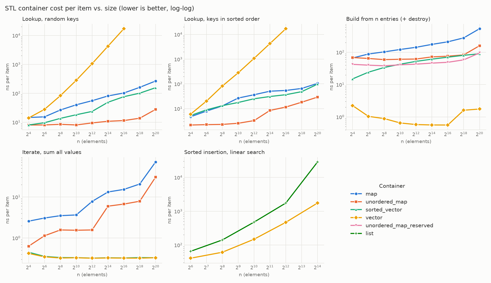

# Day 4: Container Performance Explorer
Five key → value containers behind one interface, benchmarked for lookup, build, and iteration from 16 to 1M elements, plus the vector vs. list sorted-insertion experiment. A Python script turns the results into a CSV and plots, and [`results/DECISION_GUIDE.md`](results/DECISION_GUIDE.md) turns those into recommendations.



## Project Structure

```
day4-container-performance/
├── include/containers/workloads.hpp   # Containers + deterministic input generators
├── tests/test_workloads.cpp           # Every container gives the same answers
├── benchmarks/bench_containers.cpp
├── scripts/plot_results.py            # JSON → results.csv + containers.png
└── results/                           # results.json, results.csv, containers.png, DECISION_GUIDE.md
```

## Building and Running

```bash
cmake -B build                   # Release by default; downloads Google Benchmark
cmake --build build
(cd build && ctest --output-on-failure)

./build/bench_containers --benchmark_min_time=0.2s \
    --benchmark_out=results/results.json --benchmark_out_format=json
uv run --with matplotlib scripts/plot_results.py results/results.json   # or: pip install matplotlib
```

The full suite takes a few minutes. `--benchmark_filter=lookup/` runs a single family.

## The Containers

| Name | Storage | `find` | Built by |
|---|---|---|---|
| `map` | `std::map` (red-black tree, one node per entry) | tree search | `emplace` per entry |
| `unordered_map` | `std::unordered_map` (buckets of nodes) | hash | `emplace` per entry |
| `unordered_map_reserved` | the same | hash | `reserve(n)`, then `emplace` |
| `sorted_vector` | `std::vector<std::pair<K, V>>` | `std::lower_bound` | copy, then `std::sort` |
| `vector` | `std::vector<std::pair<K, V>>` | linear `std::find_if` | copy |

## Design Notes
- **Unique keys without a dedup pass**: keys are `splitmix64(i)`, whose finalizer is a bijection on 64-bit integers. Missing keys come from a range `make_entries` never reaches.
- **Lookups cycle through at least 64K keys**, in batches of 1024 per iteration. Repeating a few lookups would measure the cache and the branch predictor, not the container (Day 3's lesson).
- **Lookups are independent**, so the CPU overlaps several cache misses at once. That's realistic throughput, but a pointer-chasing workload, where each lookup depends on the previous one, would show higher latency.
- **Build includes destruction**: freeing a million tree nodes is part of what a `std::map` costs you.
- **`vector` lookups stop at 64K**: past that, O(n) per lookup takes minutes.
- **Tests run in Release** with a `check()` helper instead of `assert`, which `NDEBUG` would compile away.
