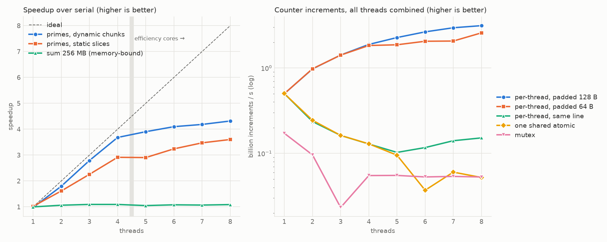

# Day 6: Concurrent Task Processor
A bounded blocking queue, a thread pool with futures, and a `parallel_for`. All of it is tested for thread safety, including under ThreadSanitizer, then used to measure what parallelism buys: compute-bound vs. memory-bound scaling, static vs. dynamic work splitting, and the cost of sharing data between cores. Findings, with numbers, are in [`results/ANALYSIS.md`](results/ANALYSIS.md).



## Project Structure

```
day6-concurrent-calculator/
├── include/concurrency/
│   ├── bounded_queue.hpp   # MPMC blocking queue: mutex + 2 condition variables, close()
│   ├── thread_pool.hpp     # ThreadPool::submit() -> std::future, parallel_for
│   └── workloads.hpp       # Prime counting (static / dynamic) and array sum
├── tests/                  # queue, pool, workloads (also run under TSan)
├── examples/race_demo.cpp  # A deliberate data race for ThreadSanitizer to catch
├── benchmarks/bench_scaling.cpp
├── scripts/plot_scaling.py
└── results/                # scaling.json, scaling.png, ANALYSIS.md
```

## Building and Running

```bash
cmake -B build && cmake --build build              # Release by default
(cd build && ctest --output-on-failure)

# Same tests under ThreadSanitizer (no benchmarks in this build)
cmake -B build-tsan -DDAY6_TSAN=ON && cmake --build build-tsan
(cd build-tsan && ctest --output-on-failure)
./build-tsan/race_demo                             # TSan reports the race in race_demo.cpp

./build/bench_scaling --benchmark_repetitions=3 --benchmark_display_aggregates_only=true \
    --benchmark_out=results/scaling.json --benchmark_out_format=json
uv run --with matplotlib scripts/plot_scaling.py results/scaling.json
```

## Design Notes
- **`BoundedQueue`**: `push` waits on `not_full_`, `pop` waits on `not_empty_`, each with a predicate, so spurious wakeups are harmless. It notifies *after* unlocking, so the woken thread doesn't immediately block on the mutex. `close()` is the only shutdown mechanism: blocked threads wake, pushes fail, pops drain what's left and then return `nullopt`. Consumers just loop on `while (auto item = q.pop())`.
- **Bounded on purpose**: a full queue blocks the producer. That's backpressure. An unbounded queue turns a slow consumer into unbounded memory growth instead.
- **`ThreadPool::submit`** wraps the call in a `std::packaged_task`, so the result *and any exception* reach the caller through `future::get()`. The task sits in a `shared_ptr` because `std::function` requires a copyable callable (C++23's `std::move_only_function` fixes that). The destructor closes the queue, workers drain it, then they're joined. No queued task is dropped.
- **Deadlock to avoid**: a task that submits work to the same pool and waits on its future can deadlock once every worker is waiting. `parallel_for` is meant to be called from outside the pool.
- **`parallel_for`** rethrows the first exception, but only after *every* chunk has finished: the chunks hold a reference to `body`, which must outlive them.
- **Padding for false sharing**: Apple's libc++ reports `std::hardware_destructive_interference_size` as 64, but the M2's cache line is 128 bytes (`sysctl hw.cachelinesize`). The benchmarks measure both paddings.
- **Real time, not CPU time**: every scaling benchmark uses `UseRealTime()`. CPU time summed across threads can't tell you whether more threads finished sooner.
