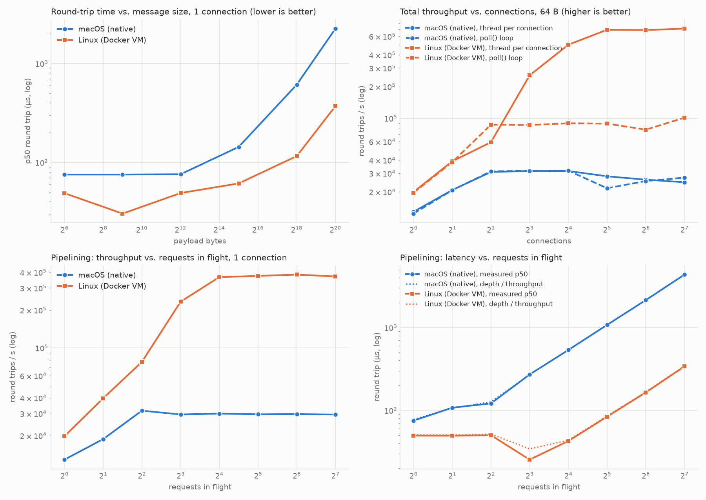

# Day 7: TCP Echo Server and Load Generator
A length-prefixed TCP echo server in two designs (a thread per connection, and a single-threaded `poll()` loop), a load generator that measures round-trip latency and throughput, and a probe that separates what the OS costs from what TCP costs. Run natively on macOS and in a Linux container, the same code shows different bottlenecks: on macOS the kernel's TCP path, in the Linux VM thread wakeups, plus a 40 ms Nagle/delayed-ACK stall that only Linux has. Findings, with numbers, are in [`results/ANALYSIS.md`](results/ANALYSIS.md).



## Project Structure

```
day7-tcp-echo/
├── include/net/
│   ├── socket.hpp          # RAII Fd, listen/connect/accept, send_all, recv_exact, socket options
│   ├── framing.hpp         # 4-byte length prefix; FrameDecoder reassembles frames from any split
│   └── echo_server.hpp     # EchoServer: thread-per-connection or poll() loop, clean stop()
├── src/
│   ├── echo_server.cpp     # CLI server: --mode threads|poll, stops on SIGINT/SIGTERM
│   ├── echo_client.cpp     # Load generator: connections × depth, Nagle/split options, JSON output
│   └── transport_probe.cpp # Pipe vs. Unix socket vs. TCP; blocking vs. spinning; send() vs. delivery
├── tests/                  # framing, sockets, both servers (also run under TSan)
├── scripts/
│   ├── run_experiments.py  # Every experiment against a fresh server; writes results/<os>.json
│   └── plot_results.py
├── Dockerfile              # Linux build that runs the experiments inside the container
└── results/                # macos.json, linux-docker.json, echo.png, ANALYSIS.md
```

## Building and Running

```bash
cmake -B build && cmake --build build              # Release by default; POSIX only (Linux, macOS, WSL)
(cd build && ctest --output-on-failure)

cmake -B build-tsan -DDAY7_TSAN=ON && cmake --build build-tsan
(cd build-tsan && ctest --output-on-failure)

# By hand: the server prints its port
./build/echo_server --port 5555 --mode threads &
./build/echo_client --port 5555 --connections 8 --depth 4 --size 64 --messages 20000
./build/echo_client --port 5555 --nagle --split --messages 50 --warmup 5   # try this on Linux
kill %1

# Everything, natively and in Linux
python3 scripts/run_experiments.py                  # -> results/macos.json (or linux.json)
docker build -t day7-tcp-echo .
docker run --rm -v "$PWD/results:/out" day7-tcp-echo --out /out/linux-docker.json
uv run --with matplotlib scripts/plot_results.py results/macos.json results/linux-docker.json
```

## Design Notes
- **TCP is a byte stream.** One `send()` can arrive as several `recv()`s, and several sends as one. Every message therefore carries a 4-byte big-endian length, and `FrameDecoder` buffers bytes until a whole frame is there. `test_framing` feeds it random splits, down to one byte at a time.
- **Never trust a length from the network.** The decoder rejects frames over 16 MB before buffering anything, and the server drops that client.
- **Partial writes are normal.** `send()` returns how much the kernel accepted; `send_all` loops. On a non-blocking socket the poll server keeps the rest and waits for `POLLOUT`.
- **One response write per read.** Both servers decode every frame that arrived in one `recv()` and answer them all with one `send()`, so pipelined requests cost fewer system calls.
- **Backpressure in the poll server**: with 1 MB of responses queued for a client, the server stops reading from it until they drain. Otherwise a client that sends without reading grows the server's memory without limit. The threaded server gets this for free: a blocking `send()` stops that thread from reading.
- **Shutdown**: `stop()` writes a byte to a pipe that the accept/poll loop also waits on (the self-pipe trick). Then `shutdown(SHUT_RDWR)` wakes every connection thread blocked in `recv()` or `send()`. A thread whose client left shuts its own socket down right away, but the descriptor stays open until the thread is joined: closing it earlier could let the number be reused by a new socket, which `stop()` would then shut down by mistake.
- **`accept()` inherits `O_NONBLOCK` on macOS, not on Linux.** The listener is non-blocking, so on macOS the threaded server's blocking `recv()` returned `EAGAIN` until accepted sockets were explicitly set back to blocking. This hung the first test run. Setting options can also fail on a connection the client already reset; that connection is dropped, not the server.
- **`SIGPIPE`**: writing to a socket whose peer has closed it raises `SIGPIPE`, which kills the process by default. Sockets set `SO_NOSIGPIPE` (macOS) or send with `MSG_NOSIGNAL` (Linux); the programs also ignore the signal.
- **Security**: everything binds to 127.0.0.1 by default. Listening on 0.0.0.0 accepts connections from your whole network.
- **IPv4 only**, to keep the socket code short; `getaddrinfo` is the way to support IPv6 and host names.
